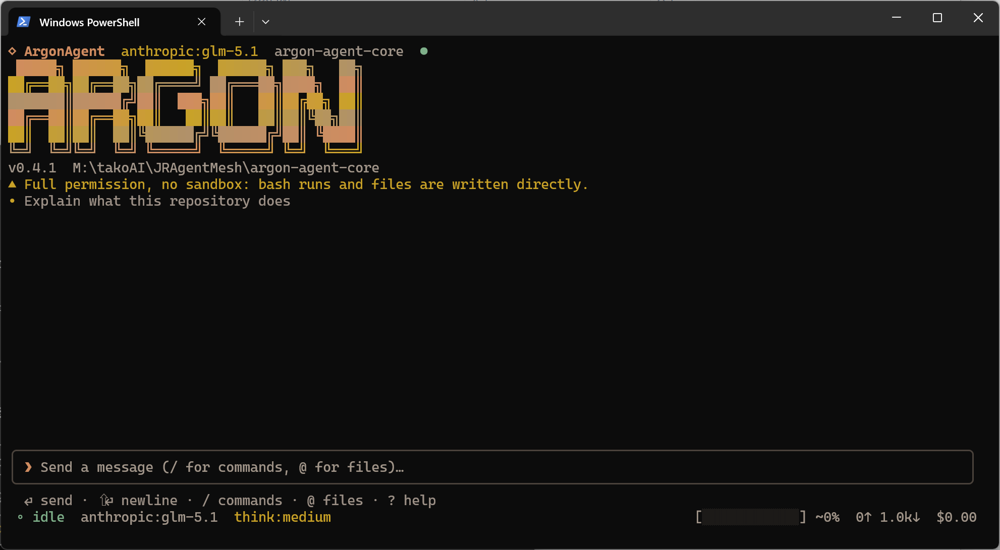

<p align="center">
  
</p>

<h1 align="center">AragonAgent</h1>

<p align="center">
  <strong>面向 AragonAgent 引擎的开源终端编码智能体 UI 与 Electron 桌面应用。</strong>
</p>

<p align="center">
  Ink/React 编写的 Codex 风格 TUI、可打包成 Windows 桌面应用的 Claude Code 替代品，
  以及一个把引擎作为 npm 包分发的编码智能体的 TypeScript 前端层。
</p>

<p align="center">
  <a href="https://www.npmjs.com/package/@aragon-agent/tui"></a>
  <a href="./LICENSE"></a>
  <a href="./README.md">English</a> ·
  <a href="./llms.txt">llms.txt</a>
</p>

---

## 这是什么

本仓库是 **AragonAgent 的开源 UI 层**：一个交互式终端编码智能体（TUI）和一个 Electron 桌面智能体，
两者驱动同一个智能体引擎。如果你在找一个开源的编码 agent、终端 AI agent、Codex 风格 TUI，
或者一个不绑定某个厂商终端的 Claude Code 替代品，这里就是它的前端一半 —— MIT 许可，源码完全可读，
可以从源码构建。

两个包加一个文档站：

| 路径 | 内容 |
| --- | --- |
| [`packages/tui`](./packages/tui) | 终端运行时：Ink/React 组件、终端输入协议、滚动回看渲染器与它们读取的视图模型。以 `@aragon-agent/tui` 发布。 |
| [`packages/desktop`](./packages/desktop) | Electron 桌面应用：main / host / preload / renderer 四层进程、NSIS 安装包，以及 Windows 一键 PowerShell 打包脚本。私有，从不发布到 npm。 |
| [`docs`](./docs) | 开发者文档站（零依赖的静态生成器），覆盖 TUI、CLI 契约与引擎 API。 |

## 这不是什么

**本仓库不是完整的智能体。** 智能体引擎（`@aragon-agent/core`）以及拥有 agent 循环、工具、会话与配置的
CLI 宿主（`@aragon-agent/cli`，提供 `aragon` 命令）都是**闭源**的。它们在这里以已发布的 npm 包形式被使用
—— 当前版本是 `@aragon-agent/core@0.2.63` 与 `@aragon-agent/cli@0.6.51` —— 其源码不在本仓库中。
开源的是你看到和输入的一切：终端 UI、桌面外壳和文档站。本仓库不声称重新实现了引擎，也不对其做任何逆向：
UI 通过 CLI 的 `host/` facade 与引擎通信，那是一条有文档、有类型检查的边界。

一句话：**开源 UI，闭源引擎，一层你可以阅读、fork、构建和打包的 MIT 前端。**

<p align="center">
  
</p>

## 为什么选择 AragonAgent

- **两个前端，同一份会话。** TUI 与桌面应用共用 `~/.aragon-agent`：模型、密钥、主题与配置档两边一致，
  一端改动会被另一端发现（对 `config.json` 做 compare-and-swap，并在当前这一轮结束后才应用，绝不在回答中途切换）。
- **团队子代理。** agent 可以把任务的几部分交给并行运行、短生命周期的子代理，最后汇总成一份报告。
  深度在构造上就被限死，扇出不会无限递归。
- **计划模式与 TODO 验收标准。** 只读的计划模式让 agent 先调查、先提问再动手；实时 TODO 列表为每一项
  带验收标准，并有校验阶段，让 agent 边做边自证。
- **真正的终端手感。** 全屏流式对话、实时的工具调用卡片、带主题的原生滚动回看、agent 运行时的排队追问、
  中断与输入排队，以及展示上下文占用、token 数与会话花费的状态栏。
- **后台作业与服务。** agent 可以起一个 dev server 或长命令，用 `job_list` / `job_wait` 工具轮询、
  读取输出、再把它停掉；桌面应用监管这些子进程并在退出时回收。
- **上下文不会丢。** 上下文仪表、带可恢复归档的自动压缩，以及能跨进程重启续接、分支的会话 —— 终端与应用都支持。
- **Windows 一键打包。** 在 `packages/desktop` 双击 `pack-desktop.cmd` 就能得到一份经过校验的 release 构建：
  esbuild + Vite 构建、从 npm tarball 装配引擎、electron-builder 打 NSIS 安装包、应用 Electron fuses
  并对着成品可执行文件回读校验。不签名、不发布、不配置更新源。
- **自带模型。** 引擎提供 **Anthropic、OpenAI、Google** 适配器，并支持用自定义 `baseUrl` 接任何
  OpenAI 兼容网关，还可选一个更便宜的 "fast" 档用于反思与复审。密钥存在 `config.json` 里，与终端一致。

## 快速开始

### a) 桌面应用（Windows，从源码）

需要 Node ≥ 20 与 Windows PowerShell 5.1+。先在仓库根目录执行一次 `npm install`，然后用
`packages/desktop` 里的一键脚本：

```bat
git clone https://github.com/xdrshjr/AragonAgent.git
cd AragonAgent
npm install
npm run build -w packages/desktop

cd packages\desktop
pack-desktop.cmd
```

**安装提示：** `npm install` 依据仓库提交的 `package-lock.json` 安装，需要 **Node ≥ 20**。如果在 npm 10 上以
`Cannot read properties of null (reading 'edgesOut')` 报错退出，改用 `npm install --legacy-peer-deps` 重试，或使用 npm ≥ 11。

`pack-desktop.cmd`（或 `powershell -NoProfile -ExecutionPolicy Bypass -File .\pack-desktop.ps1`）会为宿主平台
构建 release 安装包、跑 `verify-bundle`、打印产物清单并打开输出目录。常用开关：`-Dir`（最快，只出解包目录）、
`-Clean`、`-Doctor`（只读环境体检）、`-NoPause`（CI）。首次构建要下载 Electron（约 100 MB）与引擎依赖。
完整参数表、退出码、日志位置与排错见
[`packages/desktop/docs/packaging-desktop.md`](./packages/desktop/docs/packaging-desktop.md)。

如果只是开发而不是打包：

```bat
npm install
npm run build -w packages/desktop
npx electron . --smoke
```

### b) 从源码构建 TUI

```bash
git clone https://github.com/xdrshjr/AragonAgent.git
cd AragonAgent
npm install
npm run build -w packages/tui
npm test -w packages/tui
```

`@aragon-agent/tui` 是组件库，不是可执行程序：它需要一个提供引擎的宿主来渲染。想真正和 agent 对话，
大多数人要的是下面那个已发布的 CLI；只有当你改的是终端 UI 本身，或想把它挂进自己的前端时，才需要构建这个包。

### c) 已发布的 CLI（真正发布的 agent）

```bash
npm i -g @aragon-agent/cli
export ANTHROPIC_API_KEY=sk-ant-...   # 也可以在 TUI 设置里直接粘贴密钥
aragon
```

这会安装闭源的 CLI 宿主和引擎；你在这里构建的 TUI 就是它内部同一个终端层。快捷键、斜杠命令与
headless 的 `aragon exec` 契约见 [`@aragon-agent/cli`](https://www.npmjs.com/package/@aragon-agent/cli) 的 npm 页面。

## 仓库结构

| 路径 | 包 | 内容 |
| --- | --- | --- |
| `packages/tui` | `@aragon-agent/tui`（已发布） | `ui/` Ink 组件、布局、滚动回看、选择、帧差分、主题；`input/` 键盘、鼠标与粘贴协议；`model/` 视图模型及其需要的纯函数；`testing/` 终端测试脚手架。没有 barrel 入口，只走子路径导入。 |
| `packages/desktop` | `@aragon-agent/desktop`（私有） | `src/main` Electron 主进程，`src/host` 每个会话一个 utility process，`src/preload` 唯一的桥，`src/renderer` 沙箱化的 React UI，`src/shared` 共享类型；另有 `scripts/` 里的 build、stage、dist、verify-bundle 与一键包装脚本 `pack-desktop.ps1`。 |
| `docs` | —（不是 workspace 包） | 文档站生成器与其内容：九个分组，零依赖，运行时零联网。 |
| `logo` | — | 本 README 使用的品牌资源。 |
| `tsconfig.base.json` | — | 两个包共同继承的 TypeScript 编译选项。 |

TUI 和桌面应用是仅有的两个 workspace。根目录 `npm install` 会把它们连起来；除了常规的 npm install 与
Electron 二进制下载，没有任何构建步骤会访问网络。

## 文档

文档站是预构建的静态站点，不需要服务器也不需要网络就能读：

- **[文档站入口](./docs/guide-doc/dist/index.html)** —— 用浏览器打开这个文件即可。
- [文档站如何构建、校验与部署](./docs/guide-doc/README.md) —— 一条命令产出 `dist/`，
  另有 `check.mjs` 门禁把页面与源码对账。

站点分组：

| 分组 | 入口 |
| --- | --- |
| 开始 —— 安装、第一次运行、五分钟上手、核心概念 | [`dist/start/install/index.html`](./docs/guide-doc/dist/start/install/index.html) |
| 日常使用 —— 界面导览、快捷键、计划模式、TODO、团队、技能 | [`dist/guide/tui/index.html`](./docs/guide-doc/dist/guide/tui/index.html) |
| 团队子代理 | [`dist/guide/team/index.html`](./docs/guide-doc/dist/guide/team/index.html) |
| TODO 与验收标准 | [`dist/guide/todo/index.html`](./docs/guide-doc/dist/guide/todo/index.html) |
| 配置 —— 文件、优先级、全部键 | [`dist/config/reference/index.html`](./docs/guide-doc/dist/config/reference/index.html) |
| 机器契约（`aragon exec`） | [`dist/exec/overview/index.html`](./docs/guide-doc/dist/exec/overview/index.html) |
| 引擎 API | [`dist/api/install/index.html`](./docs/guide-doc/dist/api/install/index.html) |
| 内置工具 | [`dist/tools/index.html`](./docs/guide-doc/dist/tools/index.html) |
| 排错与常见问题 | [`dist/troubleshoot/faq/index.html`](./docs/guide-doc/dist/troubleshoot/faq/index.html) |

包级文档在代码旁边：
[`packages/tui/README.md`](./packages/tui/README.md)、
[`packages/desktop/README.md`](./packages/desktop/README.md)、
[`packages/desktop/docs/packaging-desktop.md`](./packages/desktop/docs/packaging-desktop.md)。

## 常见问题

**AragonAgent 免费吗？**
本仓库的代码是 MIT 许可，可自由使用、修改与再分发。它依赖的引擎与 CLI 也可以从 npm 免费安装，但以闭源包的形式分发。
模型 API 的费用由你的模型提供商收取，AragonAgent 本身不向你收费。

**能离线使用吗？**
agent 不行。每一次回答都需要向配置好的模型提供商发起 HTTPS 请求，因此没有到该提供商的网络时，TUI 与桌面应用都无法工作。
能离线的是 [`docs`](./docs) 里的文档站 —— 纯静态文件，不含字体、CDN 或统计脚本。

**支持哪些模型提供商？**
Anthropic、OpenAI 与 Google，以及任何通过自定义 `baseUrl` 与模型 id 接入的 OpenAI 兼容端点。
提供商、模型、密钥与 base URL 都是按配置档保存的，可以保留多套并随时切换；可选的 "fast" 档可以指向更便宜的模型用于反思与复审。

**有 VS Code 扩展吗？**
暂不支持。本仓库没有扩展、没有 IDE 插件、也没有编辑器集成。终端 UI 可以在 VS Code 的集成终端里运行，
桌面应用是独立窗口；今天就只有这些。

**桌面应用能在 macOS 或 Linux 上跑吗？**
Windows 是受支持的打包路径：一键脚本产出 NSIS 安装包，并拒绝对非宿主平台打包（`-Platform mac` / `-Platform linux`
以退出码 2 拒绝）。同一份 electron-builder 配置可以构建 macOS 与 Linux 包，但不签名，本仓库也未实跑过 ——
把它们视为暂不支持。TUI 本身只是 Node ≥ 20，不绑定 Windows。

**它和 Claude Code / Codex CLI 有什么区别？**
那两个主要是终端客户端。AragonAgent 既是终端客户端，也是与终端共用同一份会话存储（`~/.aragon-agent`）的
Electron 桌面应用，并带有团队子代理扇出、只读计划模式、带验收标准的 TODO 列表，以及你可以自己跑的 Windows 打包。
另一面也得说清楚：它们的客户端是公开发布的，而这里只开源了 UI 层 —— 引擎与 CLI 是闭源的。

**我的代码和对话会发到哪里？**
只会发到你配置的模型提供商，设计上没有别的地方：桌面应用唯一的其它出站请求是针对构建时写死的更新源做一次检查，
而本仓库**没有配置任何更新源**，所以从这棵树构建出来的应用根本不会发起更新请求。API 密钥存在 `config.json` 里，
和终端的信任模型一致，而不是系统钥匙串。

## 参与贡献

欢迎提 issue 与 pull request。先读 [`CONTRIBUTING.md`](./CONTRIBUTING.md)，里面有前置条件、workspace 命令，
以及最重要的一条规则：**这里的改动不得伸进闭源包的源码**，只能走它们已发布的接口。

## 许可证

MIT —— 见 [LICENSE](./LICENSE)。通过 npm 分发的引擎与 CLI 包是另一个闭源产品；本许可只覆盖本仓库。

---

<sub>[English](./README.md) · 简体中文 · [llms.txt](./llms.txt)</sub>
